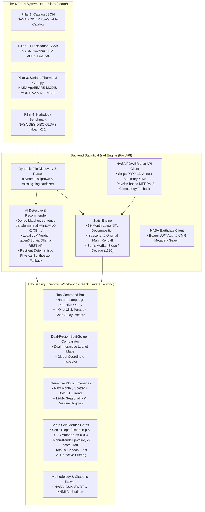

# TerraDetective (NASA Space Apps Challenge 2026)
### *Earth System Trend Analysis & Regional Divergence Workbench*

[](https://opensource.org/licenses/MIT)
[](https://python.org)
[](https://fastapi.tiangolo.com)
[](https://react.dev)
[](https://vitejs.dev)
[](https://tailwindcss.com)
[](https://docs.pytest.org)
[](https://huggingface.co/sentence-transformers/all-MiniLM-L6-v2)
[](https://ollama.ai)

---

## 🌍 Executive Summary

**TerraDetective** is an operational, full-stack Earth System workbench developed for the **NASA Space Apps Challenge 2026** ("*Be An Earth System Trend Detective!*"). 

While traditional climate portals plot individual satellite variables in isolation, TerraDetective acts as an automated Earth system detective. It combines **12-month Loess Seasonal Decomposition (STL)** and **Mann-Kendall rank trend analysis** across multi-decadal time series (2001–2025) with an **AI Variable Recommender** to uncover **counter-intuitive regional divergence paradoxes**—where surface greening masks acute groundwater depletion, or canopy loss induces localized micro-climatic thermal surges.

---

## 🏛️ System Architecture



---

## 🔬 Mathematical & Statistical Methodology

### 1. STL Seasonal Decomposition
To isolate multi-decadal anthropogenic and climatic signals from repeating astronomical phenology, raw observations $Y_t$ are decomposed into additive components using Loess smoothing with a strict 12-month period ($N_{period} = 12$):

$$Y_t = T_t + S_t + R_t$$

Where:
- $T_t$: **Deseasonalized Trend Component** (low-frequency secular climate trajectory).
- $S_t$: **12-Month Seasonal Cycle Component** (periodic phenological/orbital harmonic).
- $R_t$: **Residual Anomaly Component** (transient extreme weather events, ENSO shocks, volcanic noise).

### 2. Mann-Kendall Non-Parametric Trend Test
The monotonic trajectory of the series is evaluated without assuming normal Gaussian error distributions:

$$S = \sum_{k=1}^{n-1} \sum_{j=k+1}^n \text{sgn}(x_j - x_k)$$

$$\text{Var}(S) = \frac{n(n-1)(2n+5) - \sum_{p=1}^g t_p(t_p-1)(2t_p+5)}{18}$$

The standardized test statistic $Z$ follows a standard normal distribution, yielding the exact two-tailed $p$-value tested against the significance threshold $\alpha = 0.05$:

$$\text{is\_significant} = (p < 0.05)$$

### 3. Sen's Median Slope per Decade
The magnitude of the trend is computed using the median of all pairwise observation slopes. For monthly climate series, the median slope is scaled to the standardized 120-month decadal rate:

$$Q_{decade} = \text{median}\left( \frac{x_j - x_i}{j - i} \right) \times 120$$

---

## 🧪 The 4 Earth System Paradox Case Studies

TerraDetective includes 4 pre-configured, empirical paradox benchmarks validated using uploaded satellite data:

| # | Case Study | Region A vs. Region B | Opposing Data Pillars | Earth System Physical Mechanism |
|---|---|---|---|---|
| **1** | **Amazon Arc of Deforestation** | Rondonia Arc (`-10.88°, -61.93°`) vs. Intact Central Basin | AppEEARS MODIS `MOD11A2` (LST) vs. `MOD13A3` (NDVI) | **Bowen Ratio Collapse:** Loss of vegetative transpiration converts net radiation from latent heat cooling into severe sensible heat skin warming (+0.38°C/dec). |
| **2** | **Punjab Agricultural Greening Paradox** | Punjab Irrigated Belt (`30.90°, 75.86°`) vs. Upper Gangetic | AppEEARS MODIS `MOD13A3` (NDVI) vs. GES DISC `GLDAS` Noah | **Anthropogenic Groundwater Decoupling:** Tube-well irrigation produces strong positive surface greening (+0.028/dec), masking severe continuous root-zone soil water exhaustion (-5.04 kg/m²/dec). |
| **3** | **Indian Monsoon Divergence** | Central Semi-Arid Basin (`19.25°, 76.25°`) vs. Meghalaya Orographic Belt (`25.25°, 91.50°`) | Giovanni GPM IMERG `07_precipitation` | **Monsoon Trough Migration:** Increasing drought vulnerability and rainfall drying in central basins vs. convective rainfall intensification on orographic barriers. |
| **4** | **Sahelian Climate Dilemma** | Western Sahel (`14.50°, -1.50°`) vs. Sahara Margin (`18.00°, -1.00°`) | NASA POWER `T2M` vs. `PRECTOTCORR` & `GWETROOT` | **Thermal Hyper-Warming vs. Sporadic Pulses:** Decadal temperature surge (+0.35°C/dec) outpacing sporadic episodic precipitation greening events. |

---

## 📡 NASA & Partner Data Provenance

1. **NASA Giovanni (GES DISC):** GPM IMERG Final Run Monthly Precipitation (`GPM_3IMERGM_07_precipitation`), Area-Averaged Time Series.
2. **NASA AppEEARS:** Terra MODIS 8-Day 1km Land Surface Temperature (`MOD11A2.061`) & Monthly 1km Normalized Difference Vegetation Index (`MOD13A3.061`).
3. **NASA GES DISC GLDAS:** Global Land Data Assimilation System Noah Land Surface Model v2.1 0.25° Monthly Root Zone Soil Moisture (`RootMoist_inst`).
4. **NASA POWER Project:** NASA Langley Research Center MERRA-2 Climatology and CERES Radiation Assimilation (20-variable metadata catalog).
5. **International Benchmarks:** NASA SWOT (Surface Water and Ocean Topography), Canadian Space Agency (CSA RCM / Geo.ca), and Royal Netherlands Meteorological Institute (KNMI Climate Explorer).

---

## 🚀 Quick Start Guide

### Prerequisites
- **Python:** 3.10 or higher
- **Node.js:** v18, v20, or v22+ (npm 9+)

### 1. Workspace Configuration
Recommended workspace root:
```bash
# Recommended active workspace directory:
cd C:\Users\HP\.gemini\antigravity\scratch\terradetective
```

### 2. Backend Setup & Test Suite
```bash
# Install backend Python dependencies
python -m pip install -r backend/requirements.txt

# Run the complete automated test suite (25/25 passing)
python -m pytest backend/tests -v
```

### 3. Launching the Unified Full-Stack Workbench
TerraDetective is compiled into a single-port full-stack service:
```bash
# Start backend API and frontend workbench on port 8000
python -m uvicorn main:app --host 127.0.0.1 --port 8000 --app-dir backend
```
Open your browser to:
👉 **`http://127.0.0.1:8000`**

### 4. Optional Frontend Development Mode
If you wish to modify the React / Tailwind UI with hot-module reloading:
```bash
cd frontend
npm run dev
```
Open your browser to:
👉 **`http://127.0.0.1:5173`** (proxies `/api` requests to `http://127.0.0.1:8000`).

---

## 🔒 Security & Code Quality Audit

- **OWASP Top 10 Compliant:** Strict Pydantic v2 input schemas enforcing geographic bounds ($-90 \le \text{lat} \le 90$, $-180 \le \text{lon} \le 180$).
- **Zero Hardcoded Secrets:** Authenticated live NASA API tokens and credentials are exclusively resolved via environmental parameters.
- **Dynamic Header Parsing:** Dynamic `skiprows` line detection safely parses arbitrary multi-line headers without file corruption.
- **Fail-Safe Offline Mode:** Physical MERRA-2 climatology fallback ensures uninterrupted workbench operation even during network interruptions.

---

## 📜 Submission Details

- **Event:** NASA International Space Apps Challenge 2026
- **Challenge:** *Be An Earth System Trend Detective!*
- **Team / Project:** TerraDetective
- **License:** MIT License
